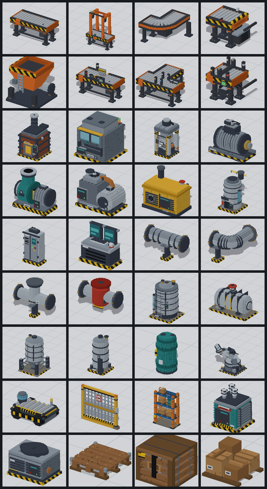
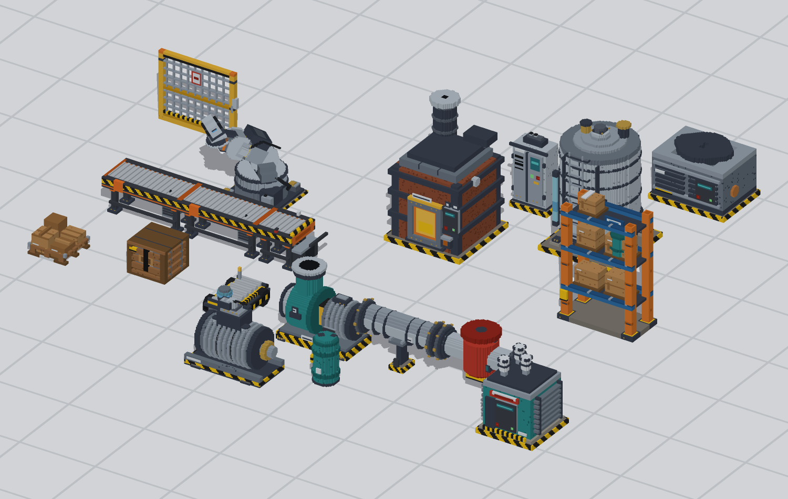

# Voxel factory -- asset set

**Sub-project of the factory engine** ([repository README](../README.md)). The
engine consumes these files; the art pipeline is generated and versioned here, and
has its own CI gate.

36 low-poly voxel models for a fully automated factory: conveyors, motors, pumps,
tanks, process machines, articulated robots, pallet racking and plant services.
The output is plain **glTF 2.0 (.glb)** plus **OBJ/MTL**, so any loader works.





---

## 1. Art spec

| Property | Value |
|---|---|
| Detail voxel | **3.13 cm** (1/32 m), so rollers, bolts and hazard stripes read |
| Authoring unit | **6.25 cm** (1/16 m), 16 units = 1 m |
| Tile grid | **2 m** (32 authoring units); belts and pipes align on it |
| Meshing | only exposed faces, greedy-merged coplanar rectangles |
| Shading | flat per-face normals, no smoothing groups |
| Colour | one **vertex-colour** attribute, no textures at all |
| Material | 1 shared PBR material per file (`metallic 0.12`, `rough 0.82`) |
| Triangles | 674 – 9154 per asset, ~109 k for the whole set |
| File size | 57 – 752 kB per GLB (8.8 MB total) |

That last point is the important one for a factory game: **every asset is one
draw call with zero texture memory**. Thousands of machines cost thousands of
draw calls, not gigabytes of atlas. Merge static belts into one mesh per
chunk and the whole factory can drop to a few dozen calls.

## 2. Files

```
assets/
  glb/            36 x .glb  <- use these
  obj/            36 x .obj + .mtl  (fallback for OBJ-only engines)
  rigs/robot_arm.json  (joint pivots, axes, limits, parent chain)
  preview/        520x420 iso renders, one per asset
  manifest.json   dimensions, ports, AABB, palette, rig list
  inventory.md    the asset table below
  gallery.html    open in a browser for a visual index
  contact_sheet.png / scene_showcase.png
  tools/          the generator (Python 3 + numpy only)
  README.md       this file
```

## 3. Coordinates and placement

* **Units: metres.** Up is **+Y**, the front face of every machine faces **+Z**.
* **Origin: bottom centre of the footprint, Y = 0 on the floor.**
  So placing an asset is `node.position = vec3(cell.x * 2.0f, 0.0f, cell.z * 2.0f)`.
* Voxel coordinates inside the generator are Z-up with the front at `y = 0`; the
  exporter rotates to glTF space (`x, z, -y`), a proper rotation (no mirroring).
* Modules declaring `tile_voxels` in the manifest (belts, pipes) are centred on
  their **tile**, not on their geometry, so a corner piece snaps to the grid even
  though its belt only occupies part of the 2 x 2 m tile.

Every asset's exact box is in `manifest.json` under `aabb` (glTF space, metres),
ready to use as a cheap collision box.

## 4. Loading a GLB in C++

No extensions, no skins, no external buffers: `POSITION` + `NORMAL` + `COLOR_0`
+ `indices`, all 4-byte aligned, one primitive per mesh. With
[cgltf](https://github.com/jkuhlmann/cgltf) (single header) it is roughly:

```cpp
#define CGLTF_IMPLEMENTATION
#include "cgltf.h"

struct Vertex { float x, y, z; float nx, ny, nz; float r, g, b; };

Mesh load_glb(const char* path) {
    cgltf_options opt{};
    cgltf_data* data = nullptr;
    if (cgltf_parse_file(&opt, path, &data) != cgltf_result_success) return {};
    cgltf_load_buffers(&opt, data, path);   // .glb: pulls the embedded BIN chunk

    Mesh out;
    for (size_t m = 0; m < data->meshes_count; ++m) {
        const cgltf_primitive& p = data->meshes[m].primitives[0];
        const cgltf_accessor* pos = nullptr;
        const cgltf_accessor* nrm = nullptr;
        const cgltf_accessor* col = nullptr;
        for (size_t a = 0; a < p.attributes_count; ++a) {
            if (p.attributes[a].type == cgltf_attribute_type_position) pos = p.attributes[a].data;
            if (p.attributes[a].type == cgltf_attribute_type_normal)   nrm = p.attributes[a].data;
            if (p.attributes[a].type == cgltf_attribute_type_color)    col = p.attributes[a].data;
        }
        const size_t base = out.vertices.size();
        for (size_t i = 0; i < pos->count; ++i) {
            Vertex v{};
            cgltf_accessor_read_float(pos, i, &v.x, 3);
            cgltf_accessor_read_float(nrm, i, &v.nx, 3);   // NORMAL is always present
            cgltf_accessor_read_float(col, i, &v.r, 3);
            out.vertices.push_back(v);
        }
        const size_t first = out.indices.size();
        out.indices.resize(first + p.indices->count);
        cgltf_accessor_unpack_indices(p.indices, out.indices.data() + first,
                                      sizeof(uint32_t), p.indices->count);
        for (size_t i = first; i < out.indices.size(); ++i) out.indices[i] += base;
    }
    cgltf_free(data);
    return out;
}
```

`cgltf_load_buffers` resolves the embedded BIN chunk for a `.glb`; for rigged
nodes read `data->nodes[i]` (`name`, `translation`, `rotation`, `mesh`).

### Vertex colours

`COLOR_0` is authored in **sRGB** (0..1) and stored as `VEC3` floats — that is
what the preview images show. Pick one of two paths:

* **Unlit / flat pipeline** (most voxel games): feed the values straight to the
  fragment shader and multiply by your own light term. Colours match the previews.
* **Linear pipeline**: convert once on load, `c = pow(c, 2.2)`, then multiply by
  lighting and write with sRGB output encoding. Mathematically correct, slightly
  darker/more contrasty than the previews.

Do not enable `GL_SMOOTH`-style normal smoothing: the mesher emits split vertices
with axis-aligned face normals, which is what gives the crisp voxel facets.

## 5. Ports — connection metadata

Every asset lists its connection points in `manifest.json` and in the glTF node
`extras`, as `pos` (metres, model space) and `dir` (unit vector pointing
**away** from the model):

```json
{ "name": "in",  "pos": [-1.0, 0.75, 0.031], "dir": [-1, 0, 0], "type": "item" },
{ "name": "out", "pos": [ 1.0, 0.75, 0.031], "dir": [ 1, 0, 0], "type": "item" }
```

Port types used: `item`, `fluid`, `gas`, `power`, `data`, `shaft`, `grasp`,
`mechanical`. To connect two machines, match a port to a port with the opposite
`dir` and the same world position — belts and pipes are authored so that
neighbouring tiles' ports coincide exactly.

## 6. Rigged assets: robot arm, gate, diverter and merge

`robot_arm.glb` is a **node hierarchy**, not a baked animation: `base` (fixed) →
`turret` (yaw) → `shoulder` (pitch) → `elbow` (pitch) → `wrist` (roll) →
`gripper` (jaw). Each node's translation is its joint position, and each part's
mesh is authored around that joint, so rotating a node is the whole animation
system:

```cpp
// rotate a joint about its own axis; parents already carry the transform
arm.find("shoulder").rotation = angle_axis(radians(shoulder_deg), {1, 0, 0});
```

Joint axes and limits are in `rigs/robot_arm.json` and in each node's `extras`
(`joint_axis`, `limits_deg`), together with the tool centre point port `grasp`
at the fingertip. Build IK on top of those five joints.

`conveyor_gate`, `conveyor_diverter` and `conveyor_merge` use the same
node-hierarchy export but with **linear** joints: their `extras` carry `joint_mode: "slide"` and
`limits_m` instead of `limits_deg`, so the animation is a translation along the
joint axis rather than a rotation.

| Asset | Moving node | Axis | Limits | Notes |
|---|---|---|---|---|
| `conveyor_gate` | `blade` | `z` | `-0.29 .. 0 m` | 0 = closed/raised, -0.29 = open (blade top level with the rollers) |
| `conveyor_diverter` | `pusher` | `y` | `0 .. 0.30 m` | 0 = retracted, 0.30 = full stroke, plate at the reject opening |
| `conveyor_merge` | `transfer` | `z` | `0 .. 0.10 m` | 0 = chain deck below the roller crown, 0.10 = links raised to grip |

```cpp
// linear joint: just translate the node along its axis
blade_node.translation += axis_vec(rig_axis) * blade_offset_m;
```

Axis names in the rig JSON are in **model space** (X right, Y back, Z up), which
is glTF `(x, y, z) = (X, Z, -Y)` after export.

## 7. A sequenced merge station

The merge controller ([`src/game/merge_station.h`](../src/game/merge_station.h)) is
a header-only C++17 controller that turns those
three linear joints into one working station: the gate meters the main line, the
pusher kicks scanned-bad items to the reject port, and the pop-up transfer
merges the side lane into a gap. It reads only the four photo-eyes the assets
actually carry, plus one request bit from the side lane:

| Input | Source |
|---|---|
| `gate_entry` | `conveyor_gate` upstream eye (0.19 m) |
| `gate_exit` | `conveyor_gate` downstream eye (0.78 m) |
| `diverter_eye` | `conveyor_diverter` eye ahead of the plate (1.47 m) |
| `merge_entry` | `conveyor_merge` entry beam, before the side-lane chamfer (3.94 m) |
| `throat` | `conveyor_merge` beam across the throat (4.25 m), or the transfer's chain-occupied bit |
| `side_waiting` | side item queued at `in_side` or still inside the transfer |
| `reject_item` | scanner verdict for the item currently at `diverter_eye` |

```cpp
#include "merge_station.h"

factory::MergeStation station;   // one per placed station

void fixed_update(float dt, const Sensors& s, Scene& scene) {
    factory::MergeStation::Inputs in;
    in.gate_entry   = s.gate_entry;
    in.gate_exit    = s.gate_exit;
    in.diverter_eye = s.diverter_eye;
    in.throat       = s.throat;
    in.side_waiting = s.side_has_item;
    in.reject_item  = s.last_scan_rejected;

    station.step(dt, in);

    const auto p = station.pose();                           // metres
    scene.node("conveyor_gate", "blade").translation[1]     = p.gate_m;
    scene.node("conveyor_merge", "transfer").translation[1] = p.transfer_m;
    scene.node("conveyor_diverter", "pusher").translation[2] = -p.pusher_m;
}
```

States are `idle` (blade open, plate home, chain down), `hold` (blade closed
while the throat is busy or the merge window is reserved), `merge` (blade
closed, chain up until the side item is through plus a clear dwell), `reject`
(plate out for `reject_dwell_s`) and `fault` (side item starved past
`watchdog_s`). Every actuator is slew-limited, so joints never jump between
poses.The transfer must never rise under a main-line item. The merge carries two
beams: `merge_entry` at 3.94 m, just upstream of the side lane's chamfer, and
the throat beam at 4.25 m. Short dead-reckoned timers bridge only the gaps
between beams, at 0.30 m/s:

| Timer | Covers | Size |
|---|---|---|
| `blind_window_s` | gate exit 0.83 m → diverter eye 1.50 m | 2.3 s |
| `diverter_to_entry_s` | diverter eye exit 1.56 m → entry beam 3.94 m | 8.0 s |
| `entry_to_strip_s` | entry beam exit 4.03 m → deck end 4.91 m | 3.0 s |
| `strip_clear_s` | throat beam 4.34 m → the same deck end | 2.05 s |

While any of them runs, no side item may claim the merge — that is the
interlock that keeps a raised chain out of a main item's path. Each stage can
now be sized to its own hop (the last one to 0.88 m instead of 3.35 m), and a
stalled item is caught by a beam instead of being assumed past.

What the extra beam does **not** buy is throughput. End to end, the side lane
still waits for the last main item to physically clear the deck — roughly 11 s
of travel at 0.30 m/s no matter how many eyes watch it. The per-stage windows
shrink; the total is set by belt speed. Splitting the merge zone into lanes
(main items run the near half, the transfer only occupies the far half) is what
would actually let both lanes run at once.

The controller that sequences these joints is game code, not asset code:
[`src/game/merge_station.h`](../src/game/merge_station.h). Its states, interlocks
and the 120 s line harness are described in the [repository README](../README.md).
What this asset set fixes is everything above -- where the beams sit, how far each
joint can travel and how fast it may move.

## 8. Regenerating and extending

The assets are **generated from code**, so they stay consistent and can be
re-styled in one place. Requires Python 3 and numpy only.

Run from the repository root (paths are resolved from the scripts, not the cwd):

```bash
python3 assets/tools/build.py               # everything: glb + obj + previews + manifest
python3 assets/tools/build.py motor pump    # only these ids
python3 assets/tools/build.py --no-render   # skip previews (fast)
python3 assets/tools/scene.py               # diorama render
python3 assets/tools/validate.py            # structural checks on every GLB/OBJ
```

Adding an asset is ~30 lines: subclass nothing, just build voxels with the
helpers and append the factory to a module's `BUILDERS` list.

```python
from voxelgen.model import Model

def widget_press():
    m = Model("widget_press")
    m.box(0, 0, 0, 32, 24, 2, "concrete_dark")        # x0,y0,z0, x1,y1,z1  (half open)
    m.box(2, 2, 2, 30, 22, 22, "steel", noise=0.05)   # noise -> weathering speckles
    m.cyl(2, 22, 16, 12, 8, 6, "teal")                # axis, start, u, v, length, radius
    m.pipe_path([(0, 12), (32, 12)], 16, 4, "galv")   # round swept pipe
    m.path_fill([(0, 12), (32, 12)], 6, 10, 12, "belt", clip=(0, 0, 32, 24))
    m.port("in", (0, 12, 12), (-1, 0, 0), "item")
    m.info(category="process", tile="2x1", tile_voxels=(32, 24))
    return m

BUILDERS = [widget_press]
```

Helpers available: `box`, `stamp` (fill only empty), `voxel`, `clear`, `cyl`,
`tube`, `disc`, `frame`, `rail`, `grate`, `stroke` (3D tube), `path_fill`,
`pipe_path`. Colours come from `assets/tools/voxelgen/palette.py`; add a hex there and
use it by name. `noise=0.05` sprinkles 5 % of voxels in the colour's darker
sibling for grime.

Rigs use `Rig` instead of `Model`: author every part in one shared voxel space,
pass each part's joint position as `pivot`, and declare the joint with
`axis`, `limits`, `mode` (`"rotate"` in degrees, or `"slide"` in metres) and an
optional `note`. Parts name their `parent`, so a rig is just a small tree; the
exporter writes the node hierarchy, the per-part meshes and `rigs/<asset>.json`.

## 9. Asset list

| Category | Assets |
|---|---|
| logistics | conveyor_straight, conveyor_scanner, conveyor_corner, conveyor_endstop, conveyor_hopper, pipe_straight, pipe_elbow, pipe_tee, valve |
| logistics (rigged) | conveyor_gate (blade), conveyor_diverter (pusher), conveyor_merge (transfer) |
| process | smelter_furnace, assembler, hydraulic_press |
| power | motor, generator, power_transformer |
| fluids | pump, compressor, boiler, cooling_chiller, air_receiver |
| storage | water_tank, gas_tank, silo, storage_rack |
| robotics | robot_arm (rigged, 6 joints), agv, safety_fence |
| control | control_cabinet, operator_console |
| props | pallet, crate, cardboard_boxes, barrel |

Full table with dimensions, triangle counts and port names:
[assets/inventory.md](assets/inventory.md). Visual index:
[assets/gallery.html](assets/gallery.html).

## 10. Notes and limitations

* Single-sided geometry: disable back-face culling or keep winding as authored
  (winding is correct for GL_CCW front faces).
* No LODs, no collision meshes, no baked lighting, no animations other than the
  rig hierarchy. The AABB in the manifest is the intended collision proxy.
* Glass is opaque (`glass`, `glass_dark`) — a deliberate voxel-style choice; it
  looks fine without transparency sorting. Swap the material if you want real
  transparency.
* Belts and pipes are static meshes; animate the belt surface by scrolling a
  texture or offsetting the slat geometry if you need motion. The slat stripes
  are separate faces at `belt`/`belt_dark` so they tile cleanly.
